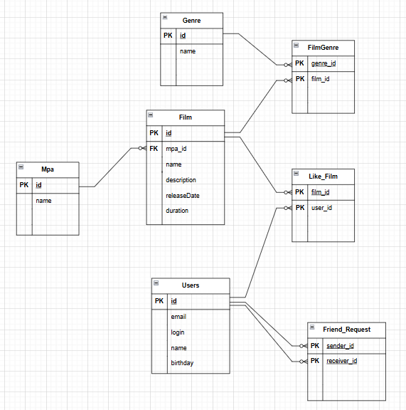

# Серверное приложение «Filmorate»
Серверное приложение для поиска фильмов, оценки их популярности и формирования персональных рекомендаций. Пользователи могут ставить/удалять фильмам лайки, оставлять отзывы, искать фильмы по режиссёру, просматривать подборку популярных фильмов, добавлять в друзья других пользователей, а также на основе общих с друзьями интересов к фильмам получать рекомендации фильмов для просмотра.

## Содержание
- [Функциональность приложения](#функциональность-приложения)
    - [Фильмы](#фильмы)
    - [Пользователи](#пользователи)
    - [Отзывы](#отзывы)
- [Диаграмма базы данных](#диаграмма-базы-данных)
- [Технологический стек](#технологический-стек)
- [Архитектура приложения](#архитектура-приложения)
- [Требования для запуска](#требования-для-запуска)

## Функциональность приложения
Filmorate предоставляет REST API для работы с фильмами, пользователями и отзывами.
### Фильмы
API позволяет управлять фильмами и информацией, связанной с ними:
- Получение, добавление, редактирование и удаление фильмов;
- Получение, добавление, редактирование и удаление режиссёров;
- Добавление и удаление лайков фильмам;
- Получение жанров и возрастных рейтингов;
- Поиск фильмов по режиссёру;
- Получение списка популярных фильмов с возможностью ограничения количества результатов и фильтрацией по жанру и году выхода.

### Пользователи
Приложение предоставляет возможности для управления пользовательскими данными:
- Получение, создание, редактирование и удаление профиля пользователя;
- Получение списка друзей пользователя;
- Добавление пользователей в друзья и удаление их из списка друзей;
-  Получение рекомендаций фильмов на основе фильмов, понравившихся друзьям пользователя;
- Поиск общих друзей двух пользователей.

### Отзывы
Приложение поддерживает методы для публикации отзывов и установки им лайков/дизлайков:
- Получение, добавление, редактирование и удаление отзывов;
- Добавление и удаление лайков и дизлайков отзывам.

## Диаграмма базы данных


### Примеры SQL запросов
#### Users

##### Вывод всех пользователей
```SELECT * FROM users;```

##### Поиск пользователя по id
```SELECT * FROM users WHERE id = ?;```

##### Вставка пользователя
```INSERT INTO users (name, email, login, birthday) VALUES (?, ?, ?, ?);```

##### Обновление информации о пользователе 
```UPDATE users SET name = ?, email = ?, login = ?, birthday=? WHERE id = ?;```

#### Film

##### Вывод всех фильмов;
```SELECT * FROM film;```

##### Поиск фильма по id
```SELECT * FROM film WHERE id = ?;```

##### Вставка фильма
```INSERT INTO film(name, mpa_id, description, release_date, duration) VALUES (?,?,?,?,?);```

##### Обновление информации о фильме
```UPDATE film SET name = ?, description = ?, duration = ?, mpa_id=?, release_date = ? WHERE id = ?;```

## Технологический стек
В проекте используются следующие технологии:
- Java — язык программирования для реализации серверной бизнес-логики;
- Spring Boot — фреймворк для разработки серверного приложения;
- Spring JDBC — инструмент для взаимодействия с реляционной базой данных;
- PostgreSQL — реляционная система управления базами данных, предназначенная для хранения и обработки данных приложения;
- Maven — инструмент для сборки проекта и управления зависимостями;
- JUnit — фреймворк для автоматизированного тестирования.

## Архитектура приложения
Серверное приложение построено на основе REST API. Оно принимает HTTP-запросы, выполняет бизнес-логику и возвращает результаты в формате JSON. Основные данные приложения хранятся в реляционной базе данных, которая включает информацию о фильмах, пользователях, жанрах, возрастных рейтингах, пользовательских оценках и дружеских связях. При обработке запросов приложение взаимодействует с базой данных, получает или изменяет необходимые сведения и возвращает клиенту результат выполнения операции.

## Требования для запуска
- JDK 21
- Maven
- PostgreSQL